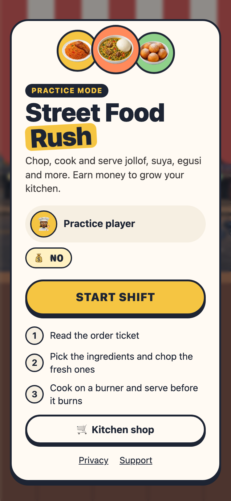
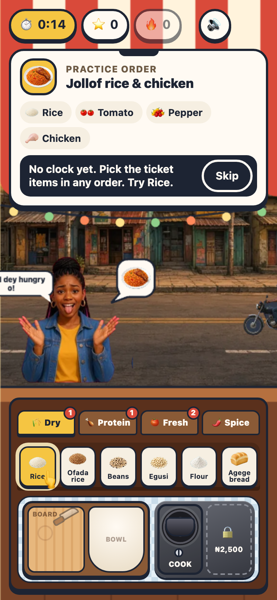
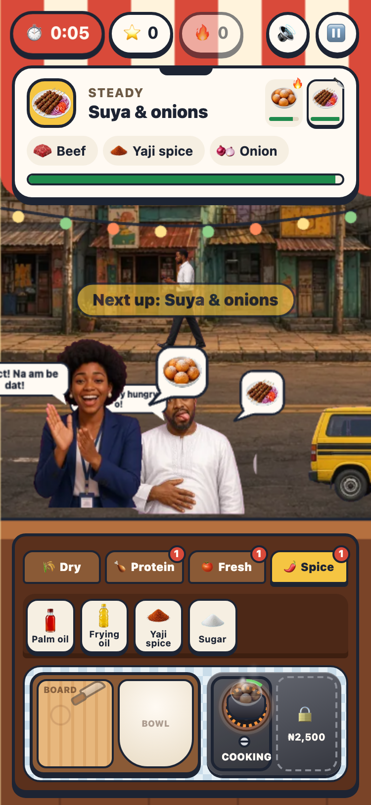
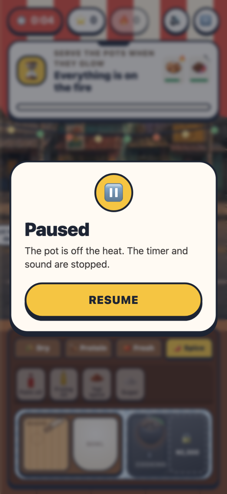
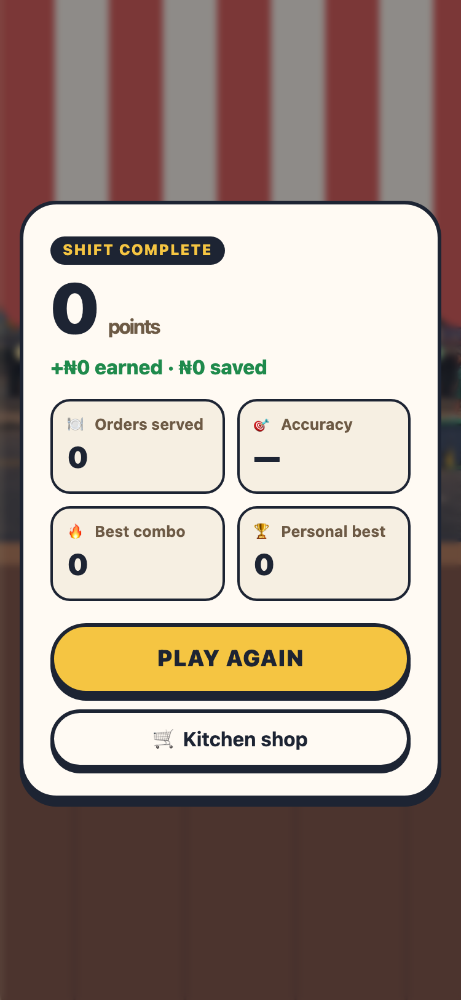

# Street Food Rush

A 90-second Lagos street-food game for the Vatar Games SDK. Practice mode runs on its own. Inside Lagos Life it can show the player, submit a score and deliver one cosmetic counter.

<p align="center">
  
  
  
  
  
</p>

## Play locally

```bash
npm install
npm run dev
```

Open http://127.0.0.1:5173. The first customer is a guided practice order of jollof rice and chicken. After that, pick the ingredients on the ticket in any order, tap the chopping board once and the knife slices through everything on it (tap again to hurry it), tap a burner to cook, then tap the pot again when it glows to serve. Up to three customers line up at the counter; tap an order ticket to work on that order. Burnt food goes in the bin and the same customer waits for a fresh pot. On phones the pantry shows one shelf at a time, with a badge for what the order still needs, and jumps to the next shelf you need after each pick. Money earned in each shift is saved on the device and buys burners, a sharper knife, faster pots, a fan, a drinks cooler and helper chefs in the kitchen shop. A shift lasts 90 seconds. Add `?duration=12` while developing to shorten it.

## Checks

```bash
npm test
npm run typecheck
npm run lint
npm run test:e2e
npm run build
```

The browser test uses a 375 × 812 phone viewport and a 1280 × 800 desktop viewport.

## Purchase server

Copy `.env.example` to `.env` and fill the server values on the machine that runs it. `VATAR_SECRET` and `VATAR_WEBHOOK_SECRET` stay on the server. `VITE_SERVER_URL` is the only value the game reads, and it is the public origin of this server.

```bash
npm run server
```

The server verifies a Vatar session, checks `GET /purchases/{id}`, grants `ankara_counter` once, then marks the purchase delivered. `POST /vatar-webhook` checks the signature and does not grant an item by itself.

## Deploy

`npm run build` writes a static site to `dist/`. `vercel.json` sends the documented `frame-ancestors` header. Point `VITE_SERVER_URL` at the deployed purchase server before building if the cosmetic counter should be offered inside Lagos Life.

Purchase server: **[Railway](deploy/railway/README.md)** (recommended) or **[VPS](deploy/vps/README.md)**.

## Vatar sandbox

While testing locally, run `npm run sandbox:host` and follow `review/SANDBOX.md`.

These steps need the Lagos Life account that will own the game:

1. Deploy the HTTPS build.
2. Sign in and submit https://lagoslife.app/developers/keys.
3. Store the one-time test secret outside this repository.
4. Create the product `ankara_counter` in the Vatar dashboard.
5. Open the sandbox and play a shift, including a test purchase.
6. Upload the icon, screenshots and descriptions in `review/`.
7. Submit for review.

The sandbox has not been confirmed from this repository because it needs those keys.
